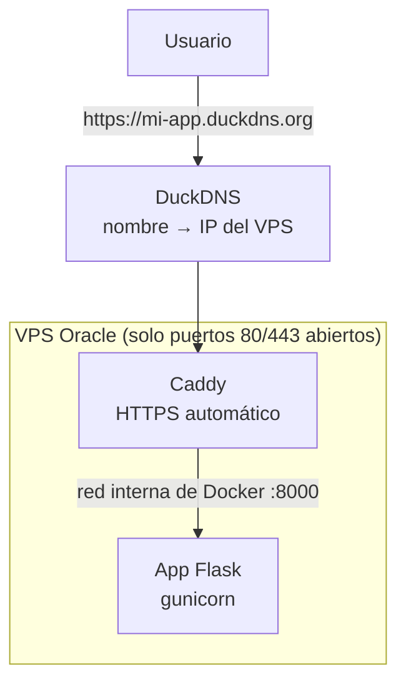

# 00 — Qué vamos a hacer

El objetivo es dejar la app Flask publicada en `https://mi-app.duckdns.org`
con HTTPS, pruebas automáticas en cada Pull Request y deploy automático al
hacer push a `main`. Todo gratis con Oracle Cloud Always Free, DuckDNS,
GitHub Actions y Vercel. Costo: $0/mes.

> Este capítulo es el mapa general. Si vienes siguiendo la guía, saltarlo.

## Las piezas

| Pieza | Qué es | Para qué la usamos |
|---|---|---|
| VPS (Oracle Cloud Always Free) | Servidor Linux encendido 24/7 con IP pública | Ahí corre la app |
| Docker | Empaqueta la app con sus dependencias | Funciona igual en mi máquina y en el servidor |
| Caddy | Reverse proxy en los puertos 80/443 | HTTPS automático con Let's Encrypt |
| DuckDNS | Subdominio gratis `mi-app.duckdns.org` | Traduce el nombre a la IP del VPS |
| GitHub Actions | Ejecuta pruebas y deploys en máquinas gratis | Cada push prueba y publica el código |
| Vercel (opcional) | Aloja el frontend | Se conecta a la API por `VITE_API_URL` |
| Cloudflare (opcional) | Worker con rate limiting | Protege la API y oculta la IP del VPS |

## Arquitectura final



Solo Caddy está expuesto a internet. La app vive en una red interna de Docker
y no es alcanzable directamente. Así está montado PlomApp en producción: la
API de Django detrás de Caddy en Oracle, el frontend en Vercel y un Worker de
Cloudflare delante.

## Cómo usar la guía

- Los capítulos van en orden del 01 al 13. Cada uno continúa el anterior.
- Los archivos que se copian al proyecto están en [`plantilla/`](https://github.com/Ricy24/guia-despliegue-flask/blob/main/plantilla/LEEME.md),
  y la app mínima con la que se prueban los pasos está en [`ejemplo/`](https://github.com/Ricy24/guia-despliegue-flask/tree/main/ejemplo).
- Donde aparezca `<TU_IP>` o `mi-app.duckdns.org` se reemplaza con los valores
  propios.

## Antes de empezar

- Proyecto Flask en un repo de GitHub. Si aún no está, se crea en
  <https://github/new> y se sube:
  ```bash
  git init
  git add .
  git commit -m "versión inicial"
  git remote add origin https://github.com/<TU_USUARIO>/<TU_REPO>.git
  git branch -M main
  git push -u origin main
  ```
- Tiempo: unas 2 horas. Oracle es lo más lento por la aprobación de la cuenta.

**Siguiente:** [01 — Las cuentas gratis](01-cuentas-gratis.md)
