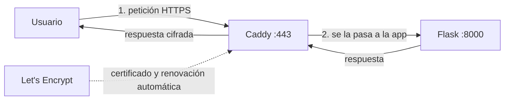

# 07 — Caddy y HTTPS

HTTPS cifra la conexión y sin él el navegador marca el sitio como "No
seguro". Normalmente conseguir el certificado gratis (Certbot) implica crons y
renovaciones a mano. Caddy lo hace solo: detecta el dominio en su
configuración, pide el certificado a Let's Encrypt y lo renueva antes de
caducar. Además es reverse proxy: recibe en 80/443 y le pasa las peticiones a
la app internamente.



## El Caddyfile

Crear la carpeta `server` en el proyecto y guardar ahí el `Caddyfile` de la
plantilla ([`plantilla/server/Caddyfile`](https://github.com/Ricy24/guia-despliegue-flask/blob/main/plantilla/server/Caddyfile)),
ajustando el dominio en la primera línea:

```
mi-app.duckdns.org {              # el dominio propio
    encode gzip                   # comprimir respuestas
    request_body { max_size 10MB } # cortar subidas gigantes
    @probe path /.env* /.git*     # bloquear sondeos de bots
    respond @probe 404
    reverse_proxy app:8000        # todo lo demás, a la app interna
}
```

`app:8000` es el nombre del servicio en el docker-compose y el puerto de
gunicorn. Los dos tienen que coincidir con el compose del capítulo 08.

## Levantar Caddy

Lo más práctico es seguir primero el capítulo 08 (que deja el compose
completo con `caddy` y `app`) y volver. Si se quiere probar Caddy solo:

```bash
mkdir -p ~/mi-app/server
nano ~/mi-app/server/Caddyfile    # pegar y ajustar el dominio
docker compose -f ~/mi-app/docker/docker-compose.yml up -d caddy
docker compose logs -f caddy
```

En los logs debe aparecer:

```
{"level":"info","msg":"certificate obtained successfully","identifier":"mi-app.duckdns.org"}
```

Abrir <https://mi-app.duckdns.org> en el navegador. Aunque la app aún no esté
arriba (502 Bad Gateway), el candado confirma que HTTPS funciona.

## Renovación

Caddy guarda el certificado en el volumen `caddy_data` y lo renueva solo cada
~60 días. Lo único que hay que sostener: no borrar ese volumen y que el
dominio siga apuntando a la IP del servidor.

> En PlomApp, el contenedor `lifeos_caddy` (imagen `caddy:2-alpine`) escucha
> en 80/443 de todo el servidor y enruta `lifeosandres.duckdns.org/plomaap-api/*`
> a `plomaap_api:8000` y el resto a su API principal, con bloqueo de
> `/.env` y `/.git` y límite de cuerpo de 12 MB. El Caddyfile de esta guía es
> la versión simplificada de ese archivo.

## Errores comunes

- **Falla al obtener el certificado**: la IP del DNS no coincide con la del
  servidor, o el puerto 80 está cerrado. Verificar con `nslookup` y con las
  dos capas de firewall (capítulos 03 y 04).
- **Rate limit de Let's Encrypt (429)**: emite ~5 certificados por dominio a
  la semana. Si se reinstaló muchas veces, esperar unos días.
- **502 Bad Gateway**: normal si la app aún no está levantada (capítulo 08).

**Siguiente:** [08 — Tu Flask en Docker](08-app-flask-en-docker.md)
