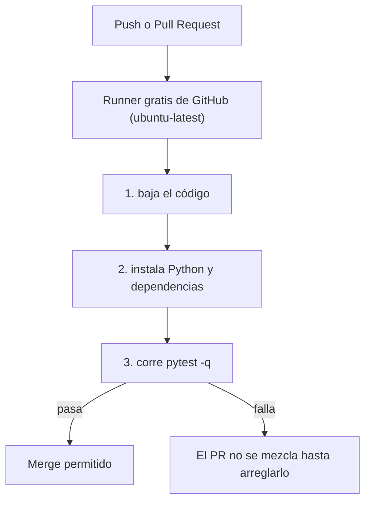

# 09 — Pruebas automáticas con GitHub Actions

CI (Integración Continua) es que en cada push o Pull Request, un robot de
GitHub corra las pruebas en una máquina gratis y marque el resultado. Si
alguien rompe algo, se entera antes de mezclar, no en la demo.



## 1. Pruebas locales primero

Un workflow corriendo pruebas rotas no sirve. Copiar la prueba de humo al
proyecto y ajustar el import:

```
tests/test_smoke.py    → de plantilla/tests/test_smoke.py
```

```powershell
pip install pytest
pytest -q
```

Para un proyecto real conviene pruebas de los endpoints críticos con el
cliente de pruebas de Flask (`app.test_client()`): no abren puertos ni tocan
la base de datos real. Buenos candidatos: login, registro, y que los errores
devuelvan el código correcto (401, 404).

## 2. El workflow

Copiar el archivo al proyecto:

```
.github/workflows/tests.yml    → de plantilla/.github/workflows/tests.yml
```

Git vigila `.github/workflows/`: en cuanto el archivo sube a `main`, el
workflow ya está activo.

Cómo funciona, en esencia (el archivo está comentado línea por línea):

```yaml
name: Pruebas
on:                    # cuándo corro
  push: {branches: [main]}
  pull_request: {branches: [main]}
jobs:
  pruebas:
    runs-on: ubuntu-latest   # máquina Ubuntu gratis de GitHub
    steps:
      - uses: actions/checkout@v4      # baja el código
      - uses: actions/setup-python@v5  # instala Python 3.12
      - run: pip install -r requirements.txt pytest
      - run: pytest -q
```

`ubuntu-latest` es una máquina virtual descartable. Los secretos locales
(`.env`) no existen ahí: si las pruebas necesitan variables, se definen con
`env:` en el workflow (así hace PlomApp con `SECRET_KEY` y `JWT_SECRET_KEY`
de prueba).

## 3. Subir y ver el resultado

```powershell
git add .
git commit -m "ci: agrega pruebas automaticas"
git push
```

La pestaña **Actions** del repo muestra el workflow corriendo. El mismo
resultado aparece en cada Pull Request.

Para que las pruebas sean requisito de merge: **Settings → Branches → Add
branch protection rule** → rama `main` → **Require status checks to pass** →
seleccionar el job `pruebas`.

> El pipeline de PlomApp corre en cada PR y push: ruff, bandit, ~500 pruebas
> unitarias en tres bases de datos (SQLite, PostgreSQL y MySQL en
> contenedores), integración, pruebas de mutación, y cobertura que hace fallar
> el pipeline si baja del 100%. Todo en paralelo, en ~10 minutos. El job
> `required` final comprueba que todos los jobs pasaron. Esto se va agregando
> por piezas; el punto de partida es el workflow de un solo job de aquí.

## Errores comunes

- **El workflow no aparece en Actions**: el archivo debe estar exactamente en
  `.github/workflows/` y en la rama `main`. En Windows, activar "mostrar
  archivos ocultos" para verificar la carpeta.
- **Límite de minutos**: solo aplica a repos privados (2000 min/mes). Los
  públicos son gratis.
- **Pasa en local y falla en Actions**: instalar las mismas dependencias
  (`requirements.txt` completo) y no usar rutas absolutas de Windows en las
  pruebas.

**Siguiente:** [10 — Despliegue automático](10-despliegue-automatico.md)
