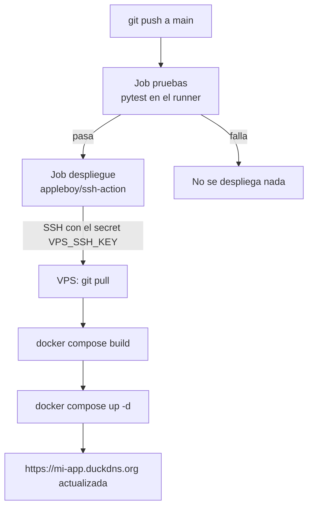

# 10 — Despliegue automático con cada push

El flujo: pruebas verdes en `main` → GitHub se conecta por SSH al VPS →
`git pull` → reconstruye el contenedor → queda publicado.



## Seguridad: la llave y los secretos

Nadie escribe IPs ni llaves en el código. El flujo es:

1. Crear una **llave SSH dedicada solo para desplegar** (no es la personal).
2. Su **llave pública** va al VPS, en `authorized_keys`.
3. Su **llave privada** va a los **Secrets de GitHub**.
4. El workflow usa esos secretos para conectarse.

## 1. La llave de despliegue

En la máquina local:

```powershell
ssh-keygen -t ed25519 -f ~\.ssh\mi-app-deploy -N '""' -C "deploy-github"
type ~\.ssh\mi-app-deploy.pub | ssh vps "cat >> ~/.ssh/authorized_keys"
ssh vps "tail -1 ~/.ssh/authorized_keys"   # confirma que apareció
```

## 2. Los secretos en GitHub

En el repo: **Settings → Secrets and variables → Actions → New repository
secret**. Crear:

| Nombre | Valor |
|---|---|
| `VPS_HOST` | la IP pública del VPS |
| `VPS_USER` | `ubuntu` |
| `VPS_SSH_KEY` | el contenido completo de `~\.ssh\mi-app-deploy`, con las líneas `BEGIN/END` (se ve con `type ~\.ssh\mi-app-deploy`) |
| `VPS_PORT` | `22` |

Si una llave se filtra, se borra del VPS (`nano ~/.ssh/authorized_keys`) y se
genera otra.

## 3. El workflow de despliegue

Copiar y ajustar la carpeta del `cd`:

```
.github/workflows/deploy.yml    → de plantilla/.github/workflows/deploy.yml
```

También hay que agregar `workflow_call:` al bloque `on:` del `tests.yml` de
la plantilla, para que `deploy.yml` lo reutilice sin duplicar el archivo. El
`deploy.yml` ya lo llama así:

```yaml
jobs:
  pruebas:
    uses: ./.github/workflows/tests.yml   # reutiliza el workflow completo
  despliegue:
    needs: pruebas                        # solo corro si las pruebas pasaron
    steps:
      - uses: appleboy/ssh-action@v1      # SSH desde el runner de GitHub
        with:
          host: ${{ secrets.VPS_HOST }}
          script: |
            cd "$HOME/mi-app"
            git pull --ff-only
            docker compose build
            docker compose up -d
```

## 4. El primer despliegue

```powershell
git add .
git commit -m "ci: despliegue automatico al VPS"
git push
```

En **Actions** se ve `Despliegue` → job `pruebas` → job `despliegue`. Si sale
bien, en el VPS:

```bash
cd ~/mi-app && git log --oneline -1 && docker compose ps
```

Y en el navegador la app ya actualizada.

## Regla del servidor

No editar archivos directamente en el servidor. Todo cambio se hace en local,
se commitea y se despliega. Si se edita en el servidor, el próximo `git pull`
falla y se rompe el deploy para todos. En PlomApp pasó: un fix de CORS hecho
a mano por SSH generó un commit de emergencia para dejar el `.env` de
producción versionado.

Si ya se rompió y `git pull` se queja:

```bash
git fetch origin && git reset --hard origin/main   # borra cambios locales
docker compose up -d --build
```

Rollback: como el código vive en Git, volver atrás es `git revert <commit>`
en local y push; el workflow se encarga del resto.

## Errores comunes

- **`Permission denied (publickey)` en el job**: el `VPS_SSH_KEY` está mal
  copiado (falta el `-----BEGIN` o se cortó), o la llave pública no está en
  `authorized_keys`.
- **`docker: permission denied`**: el usuario no está en el grupo `docker`
  (capítulo 05). `sudo usermod -aG docker ubuntu`.
- **El deploy pasa pero no cambia nada**: revisar el `cd` del script y el
  `git remote -v` del VPS.
- **Deploys pisándose**: el `concurrency` del workflow lo evita; no quitarlo.

**Siguiente:** [11 — Frontend en Vercel](11-frontend-vercel.md)
