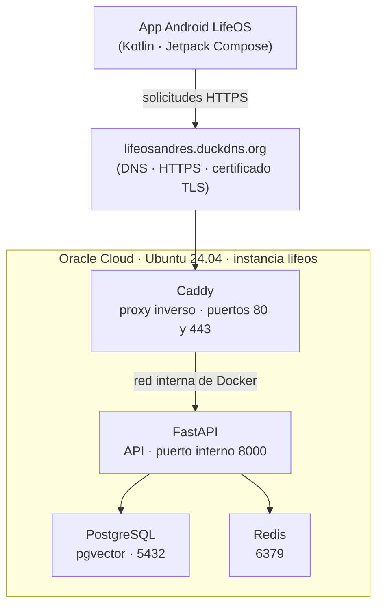
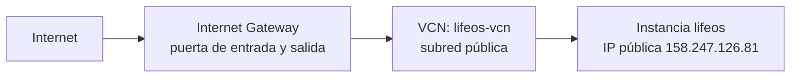
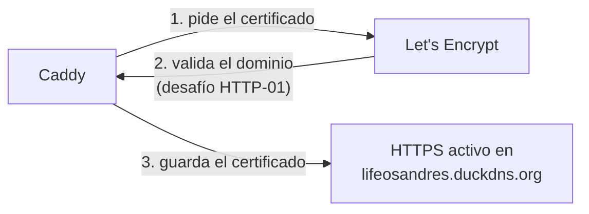

# 15 — Caso real: el servidor de LifeOS

> Reconstrucción de las conversaciones del 27 de septiembre al 30 de octubre
> de 2026. Es el recorrido completo de un servidor montado de verdad, con los
> datos reales verificados contra la instancia.

Este capítulo es la misma estructura de los capítulos 00 al 10, pero con el
contenido real: el backend de LifeOS (FastAPI) en Oracle Cloud, con Docker,
DuckDNS y Caddy con HTTPS. Sirve como referencia para saber cómo queda todo
cuando está terminado.

## Cómo leer este capítulo

Se usan tres marcas:

- **Confirmado** — dato que aparece en las conversaciones o en salidas
  compartidas.
- **Reconstruido** — paso técnico que se desprende de la configuración final.
- **No recuperado** — dato que no se puede afirmar con exactitud.

Donde aparezca **Imagen pendiente** falta la captura de pantalla. Cuando la
tengas, guarda el archivo en `docs/imagenes/lifeos/` y reemplaza ese bloque por
la imagen, por ejemplo:

```markdown

```

## 1. Qué construimos

Se construyó un servidor en Oracle Cloud Infrastructure (OCI) para alojar el
backend de LifeOS. La arquitectura final quedó así:



La idea fue tener un servidor que funcionara permanentemente y que pudiera
recibir peticiones de la aplicación, almacenar información y ejecutar la
lógica del backend.

> **Imagen pendiente:** diagrama o captura de la arquitectura final (opcional:
> si quieres, captura este propio diagrama cuando esté publicado en el sitio).

## 2. Creación de la cuenta y selección de la región de Oracle

**Confirmado** — la infraestructura se creó con estos datos:

| Característica | Configuración |
|---|---|
| Proveedor | Oracle Cloud Infrastructure |
| Región | Bogotá |
| Identificador de región | `sa-bogota-1` |
| Instancia | `lifeos` |
| Sistema operativo | Ubuntu 24.04.5 LTS |
| Hostname | `lifeos` |

La región importa porque determina dónde se encuentran físicamente los
recursos y qué capacidad de cómputo puedes solicitar.

En Oracle, cuando creas una máquina virtual, no solamente eliges una región.
También debes elegir un Availability Domain cuando corresponda, una imagen y
una configuración de hardware.

> **Imagen pendiente:** pantalla de selección de región al crear la instancia,
> con `Bogotá (sa-bogota-1)` marcado.

### 2.1. El problema de disponibilidad de máquinas

Este es uno de los puntos que nos dio problemas.

Inicialmente intentamos utilizar una instancia de la familia ARM:

```text
VM.Standard.A1.Flex
```

Esta familia utiliza procesadores ARM Ampere y es especialmente interesante
para servidores económicos.

Sin embargo, Oracle puede mostrar errores de capacidad al intentar crear una
máquina: significa que no hay capacidad disponible para esa configuración en
el dominio de disponibilidad seleccionado en ese momento.

En nuestras conversaciones quedó registrado que tuvimos problemas de capacidad
con A1 Flex. Después terminamos utilizando una máquina diferente.

> **Imagen pendiente:** mensaje de error de capacidad ("Out of host capacity"
> o similar) al intentar crear la instancia A1 Flex.

### 2.2. La máquina que finalmente quedó funcionando

**Confirmado** — instancia LifeOS, desplegada:

| | |
|---|---|
| Shape | `VM.Standard3.Flex` |
| CPU | 1 OCPU |
| RAM | 16 GB |

Región: `sa-bogota-1` · Hostname: `lifeos`

Esta es una distinción importante: la instancia final que aparece documentada
es `VM.Standard3.Flex`, no `VM.Standard.A1.Flex`.

No se recuperó con certeza el nombre del Availability Domain que falló, ni
todos los shapes intermedios que se probaron. Tampoco sería correcto afirmar
que la máquina final fue A1 simplemente porque se intentó utilizar al
principio.

> **Verificado:** la metadata de la instancia confirma
> `availabilityDomain: SA-BOGOTA-1-AD-1`. Ese es el AD donde la instancia
> quedó creada; el AD donde falló la A1 sigue sin registrar.

> **Imagen pendiente:** pantalla de detalle de la instancia en la consola de
> Oracle, donde se ve `VM.Standard3.Flex`, 1 OCPU, 16 GB y la IP pública.

## 3. Sistema operativo: instalación de Ubuntu

**Confirmado** — se eligió Ubuntu 24.04.5 LTS.

Ubuntu es una distribución de Linux muy utilizada para servidores porque
ofrece:

- Administración mediante terminal.
- Gestión de paquetes con `apt`.
- Compatibilidad con Docker.
- Actualizaciones de seguridad.
- Soporte prolongado (LTS).

Cuando la instancia se creó, Oracle permitió conectarnos con un usuario Linux
llamado `ubuntu`. El nombre del servidor quedó como `lifeos`.

Cuando entrabas por SSH, estabas administrando ese sistema operativo de forma
remota, sin necesidad de tener una pantalla o escritorio gráfico.

## 4. Configuración de redes en Oracle Cloud

Esta parte es especialmente importante porque una máquina virtual no queda
automáticamente accesible desde Internet por el simple hecho de crearla. Hay
que configurar la red virtual.

### 4.1. ¿Qué es una VCN?

En Oracle se utiliza una Virtual Cloud Network (VCN). Es una red privada
virtual donde viven tus recursos. En el proyecto quedó documentado el nombre
`lifeos-vcn`.

La estructura lógica que necesitábamos era:



### 4.2. Los componentes de red

Para que esa arquitectura funcionara, Oracle necesitaba estos componentes:

| Componente | Función |
|---|---|
| VCN | Red virtual privada |
| Subred pública | Permite alojar recursos con acceso público |
| Internet Gateway | Conecta la VCN con Internet |
| Route Table | Define por dónde sale el tráfico |
| Security List o NSG | Controla qué conexiones se permiten |
| IP pública | Permite encontrar el servidor desde Internet |

Lo que sí se recuperó: el nombre `lifeos-vcn` y que se trabajó con una subred
pública.

Lo que no se recuperó: el CIDR exacto de la VCN, el CIDR de la subred, el
nombre de la tabla de rutas, el nombre del Internet Gateway y si las reglas
quedaron en una Security List o en un Network Security Group. No se van a
inventar esos valores.

### 4.3. Puertos de red

Los puertos que se necesitaban para el servidor eran:

| Puerto | Protocolo | Uso |
|---|---|---|
| 22 | TCP | SSH |
| 80 | TCP | HTTP |
| 443 | TCP | HTTPS |
| 443 | UDP | HTTP/3, utilizado por Caddy |

La configuración final de Docker confirmó que Caddy publicaba los puertos 80
y 443.

PostgreSQL y Redis no debían exponerse directamente a Internet. Se comunicaban
internamente por la red de Docker. Esto es importante: no era necesario abrir
públicamente los puertos 5432 y 6379.

> **Imagen pendiente:** sección Networking → VCN de la consola de Oracle, con
> `lifeos-vcn` y la subred pública visibles.

## 5. Creación y utilización de la clave SSH

**Confirmado** — para conectarnos desde Windows se utilizó SSH. Oracle permite
utilizar un par de claves:

- Clave privada: permanece en tu computador.
- Clave pública: se registra en la instancia.

En la conversación quedó registrado este archivo:

```text
ssh-key-2026-09-27.key
```

Y este comando de conexión:

```powershell
ssh -i "$env:USERPROFILE\Downloads\ssh-key-2026-09-27.key" ubuntu@158.247.126.81
```

Desglose:

| Parte | Significado |
|---|---|
| `ssh` | Inicia una conexión SSH |
| `-i` | Indica qué clave privada utilizar |
| Ruta `.key` | Ubicación de la clave privada |
| `ubuntu` | Usuario de Linux |
| `158.247.126.81` | IP pública del servidor |

Una vez conectados, estábamos dentro de Ubuntu.

También quedó documentado que en una ocasión se utilizó:

```powershell
cd C:\Users\Anrid\.ssh
```

Y que hubo una clave descargada específicamente para la consola serial de
Oracle. Esa clave era diferente de la clave SSH original de la máquina.

**Importante:** no compartas tu archivo `.key`. Si alguien obtiene esa clave y
tiene acceso permitido al servidor, podría intentar conectarse como tú.

> **Imagen pendiente:** terminal de Windows con la conexión SSH establecida,
> mostrando el prompt `ubuntu@lifeos:~$`.

## 6. Instalación y despliegue de Docker

**Configuración final confirmada**

Una vez dentro de Ubuntu, el objetivo era no instalar todos los servicios de
LifeOS directamente sobre el sistema operativo. En lugar de eso, se utilizó
Docker, que permite ejecutar aplicaciones y servicios dentro de contenedores
aislados.

En el servidor quedaron cuatro contenedores:

| Contenedor | Función |
|---|---|
| `lifeos_caddy` | Proxy inverso y HTTPS |
| `lifeos_api` | Backend FastAPI |
| `lifeos_postgres` | Base de datos |
| `lifeos_redis` | Caché y almacenamiento temporal |

No está recuperada una transcripción íntegra de cada comando de instalación de
Docker, así que no se afirma que se ejecutó una secuencia concreta de
instalación. La arquitectura final sí confirma que Docker Engine y Docker
Compose estaban instalados y funcionando.

### 6.1. Estructura de archivos del servidor

El proyecto terminó ubicado en `~/lifeos`. Cuando se ejecutó `ls`
aparecieron archivos y carpetas como:

```text
lifeos/
│
├── .env
├── .env.example
├── .env.production.example
│
├── backend/
│
├── caddy/
│   └── Caddyfile
│
├── docker-compose.yml
│
└── ...
```

El archivo `.env` contenía las variables de configuración y los secretos. El
archivo `docker-compose.yml` definía cómo se levantaban los contenedores.

> **Imagen pendiente:** salida de `ls -la ~/lifeos` dentro de la sesión SSH.

## 7. Configuración de Docker Compose

Esta es una de las partes que quedó mejor documentadas porque se compartió el
contenido del archivo. El despliegue estaba compuesto por cuatro servicios.

> **Imagen pendiente:** el archivo `docker-compose.yml` abierto en el editor
> o en `nano` dentro del servidor.

### 7.1. Caddy

```yaml
caddy:
  image: caddy:2-alpine
  container_name: lifeos_caddy
  restart: unless-stopped
  ports:
    - "80:80"
    - "443:443"
  volumes:
    - ./caddy/Caddyfile:/etc/caddy/Caddyfile:ro
    - caddy_data:/data
    - caddy_config:/config
```

Qué significa:

- `caddy:2-alpine`: utiliza la imagen de Caddy.
- `container_name`: establece el nombre del contenedor.
- `restart: unless-stopped`: intenta mantenerlo funcionando después de
  reinicios.
- `80:80`: expone HTTP.
- `443:443`: expone HTTPS.
- `Caddyfile`: monta nuestra configuración.
- `caddy_data`: conserva certificados y datos.
- `caddy_config`: conserva configuraciones de Caddy.

### 7.2. FastAPI

```yaml
api:
  build:
    context: ./backend
    dockerfile: Dockerfile
  container_name: lifeos_api
  restart: unless-stopped
```

El backend se construía desde la carpeta `./backend` y utilizaba el puerto
interno `8000`.

Entre las variables de entorno que se compartieron estaban:

```text
DATABASE_URL=
SECRET_KEY=
JWT_SECRET=
ADMIN_EMAIL=
ADMIN_PASSWORD=
CRON_SECRET=
AI_PROVIDER=
GEMINI_API_KEY=
OPENAI_API_KEY=
DEFAULT_CURRENCY=COP
TIMEZONE=America/Bogota
```

También estaban las variables de Telegram:

```text
TELEGRAM_BOT_TOKEN=
TELEGRAM_ALLOWED_USER_ID=
TELEGRAM_WEBHOOK_URL=
TELEGRAM_WEBHOOK_SECRET=
```

### 7.3. PostgreSQL

Se utilizó:

```yaml
image: pgvector/pgvector:pg16
```

Esto significa que la base de datos utilizaba PostgreSQL 16 con soporte de
pgvector. pgvector permite almacenar y consultar vectores, algo útil para
funciones de búsqueda semántica e inteligencia artificial.

El contenedor se llamaba `lifeos_postgres` y la información persistía en un
volumen `postgres_data`.

### 7.4. Redis

Se utilizó:

```yaml
image: redis:7-alpine
```

El contenedor se llamaba `lifeos_redis`. Su función era proporcionar
almacenamiento rápido en memoria para datos temporales, caché y otros
procesos.

### 7.5. Red interna de Docker

En el archivo Compose quedó definida:

```yaml
networks:
  lifeos_net:
    driver: bridge
```

Esto creó una red privada para los contenedores. Por eso Caddy podía
comunicarse con FastAPI utilizando `api:8000`, y FastAPI podía comunicarse con
PostgreSQL utilizando `postgres:5432`. No era necesario que los servicios se
buscaran por la IP pública del servidor.

## 8. Cómo comprobamos que los contenedores funcionaban

Se ejecutó:

```bash
docker ps
```

Y se obtuvo una salida similar a esta:

| Contenedor | Imagen | Estado |
|---|---|---|
| `lifeos_caddy` | `caddy:2-alpine` | Up |
| `lifeos_api` | `lifeos-api` | Up |
| `lifeos_redis` | `redis:7-alpine` | Up |
| `lifeos_postgres` | `pgvector/pgvector:pg16` | Up |

También se ejecutó:

```bash
sudo ss -tulpn
```

Y se comprobó que estaban ocupados:

```text
0.0.0.0:80
0.0.0.0:443
0.0.0.0:22
```

Eso permitió comprobar que SSH estaba escuchando, y que Caddy tenía el puerto
HTTP y el puerto HTTPS. En ese momento no era necesario instalar Nginx ni
configurar Apache: Caddy ya estaba haciendo el trabajo de proxy inverso.

> **Imagen pendiente:** salida de `docker ps` con los cuatro contenedores en
> estado `Up`.

> **Imagen pendiente:** salida de `sudo ss -tulpn` mostrando los puertos 22,
> 80 y 443 en escucha.

## 9. Cómo convertimos la IP pública en un dominio

Al principio teníamos una dirección IP:

```text
158.247.126.81
```

Podíamos acceder al backend usando `http://158.247.126.81/docs` y nos
mostraba Swagger de FastAPI. Pero queríamos una dirección más fácil de
recordar, como `lifeosandres.duckdns.org`. Para eso se utilizó DuckDNS.

### 9.1. ¿Qué hace DuckDNS?

DuckDNS ofrece subdominios gratuitos que pueden apuntar a una dirección IP. No
convierte literalmente una IP en otra cosa: crea un registro DNS. La relación
que se estableció fue:

```text
lifeosandres.duckdns.org   →   158.247.126.81
(registro DNS A)               (IP pública de Oracle)
```

El registro DNS A relaciona un nombre de dominio con una dirección IPv4.

> **Imagen pendiente:** panel de DuckDNS con el dominio `lifeosandres`
> apuntando a `158.247.126.81`.

### 9.2. ¿Cómo comprobamos que funcionaba?

Se ejecutó:

```bash
getent hosts lifeosandres.duckdns.org
```

Y se recibió:

```text
158.247.126.81 lifeosandres.duckdns.org
```

Eso confirmó que el dominio estaba resolviendo hacia la IP pública del
servidor.

> **Imagen pendiente:** salida de `getent hosts lifeosandres.duckdns.org`.

Una precisión: DuckDNS es gratuito, pero no existe una garantía absoluta de
que un subdominio gratuito vaya a mantenerse para siempre. Depende de que el
servicio siga existiendo y de que la cuenta y el dominio se mantengan activos.

## 10. Configuración de Caddy y HTTPS

**Certificado emitido** — este fue el último gran cambio de infraestructura
que se hizo.

Inicialmente el archivo `~/lifeos/caddy/Caddyfile` tenía esta configuración:

```caddyfile
:80 {
    encode gzip zstd

    header {
        X-Content-Type-Options "nosniff"
        X-Frame-Options "DENY"
        Referrer-Policy "strict-origin-when-cross-origin"
    }

    reverse_proxy api:8000 {
        header_up Host {host}
        header_up X-Real-IP {remote_host}
        header_up X-Forwarded-For {remote_host}
        header_up X-Forwarded-Proto {scheme}
    }
}
```

El problema era que `:80` indicaba que Caddy estaba configurado para escuchar
en HTTP, sin declarar el dominio para activar automáticamente HTTPS.

### 10.1. Cambiamos la configuración

Se sustituyó `:80 {` por `lifeosandres.duckdns.org {`. El archivo terminó
así:

```caddyfile
lifeosandres.duckdns.org {
    encode gzip zstd

    header {
        X-Content-Type-Options "nosniff"
        X-Frame-Options "DENY"
        Referrer-Policy "strict-origin-when-cross-origin"
    }

    reverse_proxy api:8000 {
        header_up Host {host}
        header_up X-Real-IP {remote_host}
        header_up X-Forwarded-For {remote_host}
        header_up X-Forwarded-Proto {scheme}
    }
}
```

Al indicar el dominio directamente, Caddy pudo gestionar automáticamente el
certificado TLS.



> **Imagen pendiente:** el Caddyfile antes del cambio (con `:80`) y después
> del cambio (con el dominio). Pueden ser dos capturas o una sola con la
> línea resaltada.

### 10.2. Recargamos Caddy

Se ejecutó:

```bash
docker compose up -d caddy
```

Después se validó el archivo:

```bash
docker exec lifeos_caddy caddy validate --config /etc/caddy/Caddyfile
```

Y se recibió:

```text
Valid configuration
```

Luego se recargó la configuración:

```bash
docker exec lifeos_caddy caddy reload --config /etc/caddy/Caddyfile
```

Finalmente se revisaron los registros:

```bash
docker logs --tail 50 lifeos_caddy
```

### 10.3. La emisión del certificado

En los logs aparecieron mensajes importantes:

```text
enabling automatic TLS certificate management
```

Después:

```text
obtaining certificate
identifier: lifeosandres.duckdns.org
```

Y finalmente:

```text
authorization finalized
authz_status: valid
```

También apareció:

```text
validations succeeded; finalizing order
```

Esto significa que Caddy pudo demostrar que controlábamos el dominio y
completar la validación de Let's Encrypt.

**Confirmado** — el certificado se emitió correctamente.

Además, Caddy habilitó la redirección automática:

```text
enabling automatic HTTP->HTTPS redirects
```

Por eso el acceso final debía ser `https://lifeosandres.duckdns.org/docs`, y
una visita a HTTP debía redirigirse a HTTPS.

> **Imagen pendiente:** salida de `docker logs lifeos_caddy` con las líneas de
> obtención del certificado.

> **Imagen pendiente:** navegador en `https://lifeosandres.duckdns.org/docs`
> con el candado visible en la barra de direcciones.

## 11. Estado de la configuración al terminar

Este es el resumen del servidor documentado.

| Proveedor | Oracle Cloud |
|---|---|
| Región | `sa-bogota-1` |
| Instancia | `lifeos` |
| Shape final | `VM.Standard3.Flex` |
| CPU | 1 OCPU |
| Memoria | 16 GB |
| Linux | Ubuntu 24.04.5 LTS |
| Usuario | `ubuntu` |
| IP pública | `158.247.126.81` |
| Dominio | `lifeosandres.duckdns.org` |
| Proxy | Caddy 2 Alpine |
| Backend | FastAPI |
| Base de datos | PostgreSQL 16 + pgvector |
| Caché | Redis 7 |
| Contenedores | Docker Compose |
| HTTPS | Let's Encrypt mediante Caddy |

> **Imagen pendiente:** pantalla de la instancia en la consola de Oracle con
> la ficha completa (estado "Running", shape, region, IP).

## 12. Comandos útiles para administrar el servidor

Estos son los comandos que conviene conservar. Algunos son de inspección y se
utilizaron durante la configuración; otros son comandos estándar para
administrar la instalación actual.

**Conectarse desde Windows:**

```powershell
ssh -i "$env:USERPROFILE\Downloads\ssh-key-2026-09-27.key" ubuntu@158.247.126.81
```

**Entrar al proyecto:**

```bash
cd ~/lifeos
```

**Revisar contenedores:**

```bash
docker ps        # en ejecución
docker ps -a     # todos, incluidos los detenidos
```

**Ver registros:**

```bash
docker logs --tail 50  lifeos_caddy
docker logs --tail 100 lifeos_api
docker logs --tail 100 lifeos_postgres
docker logs --tail 100 lifeos_redis
```

**Levantar servicios:**

```bash
docker compose up -d                    # todo
docker compose up -d --build api        # reconstruir y levantar el backend
```

**Revisar puertos:**

```bash
sudo ss -tulpn
```

**Comprobar DNS:**

```bash
getent hosts lifeosandres.duckdns.org
```

**Validar Caddy:**

```bash
docker exec lifeos_caddy caddy validate --config /etc/caddy/Caddyfile
```

## 13. Lo que todavía nos faltaría documentar

Hay información que no se pudo recuperar de las conversaciones anteriores.
Está identificada para que no confundamos una reconstrucción con un registro
histórico:

| Dato pendiente | Por qué importa |
|---|---|
| Availability Domain exacto | Saber dónde se intentó crear la instancia |
| Shapes intermedios probados | Reconstruir los errores de capacidad |
| CIDR de `lifeos-vcn` | Conocer el rango de direcciones de la red |
| CIDR de la subred | Documentar la red pública |
| Internet Gateway | Registrar su configuración exacta |
| Route Table | Conservar las rutas de red |
| Security List / NSG | Conservar las reglas exactas de entrada |
| Tipo de IP pública | Saber si es reservada o efímera |
| Comandos originales de instalación | Reproducir literalmente la instalación inicial |

Estos datos se pueden recuperar consultando la consola de Oracle y el servidor
actual, sin tener que recrear nada.

Por ejemplo, para conocer el estado de la red desde Ubuntu:

```bash
ip addr
ip route
sudo ufw status verbose
```

Y para los recursos de Oracle, revisar las secciones de Networking, VCN,
Subnets, Gateways y Security Lists de la consola.

## 14. El siguiente paso: terminar la integración de Telegram

Queda una tarea pendiente: integrar el bot de Telegram con el backend.

Ya tenemos:

- Dominio.
- DNS apuntando a la IP pública.
- Caddy.
- HTTPS.
- Variables de entorno preparadas para Telegram.
- Backend FastAPI funcionando en Docker.

El archivo `.env` tenía estas variables:

```text
TELEGRAM_BOT_TOKEN=
TELEGRAM_ALLOWED_USER_ID=
TELEGRAM_WEBHOOK_SECRET=
TELEGRAM_WEBHOOK_URL=
```

Todavía hay que revisar las rutas reales del webhook en el código del
backend, configurar la URL correcta y verificar el registro del webhook con
Telegram. No se debe inventar la ruta hasta inspeccionar el código.

Con esto queda cubierto el manual de reinstalación: si algún día cambias de
servidor o pierdes el acceso a Oracle, la referencia está aquí.

**Siguiente:** [Troubleshooting](troubleshooting.md)
