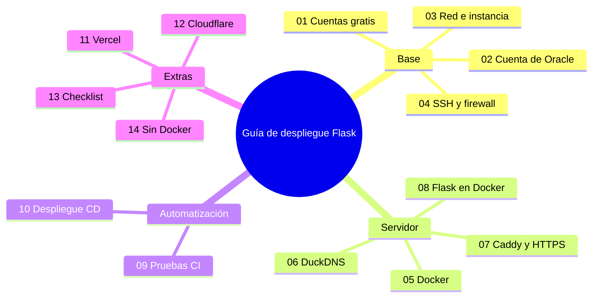

# Guía de despliegue Flask

Mapa mental de todo el recorrido:



Al terminar la guía queda la app Flask publicada en
`https://tu-app.duckdns.org` con HTTPS, pruebas en cada Pull Request y deploy
automático al hacer push a `main`. Todo gratis: Oracle Cloud Always Free,
DuckDNS, GitHub Actions y Vercel.

## Cómo se usa

1. Seguir los capítulos en orden, del 00 al 13. Cada uno continúa el anterior.
2. Cuando el capítulo lo pida, copiar archivos de [`plantilla/`](https://github.com/Ricy24/guia-despliegue-flask/tree/main/plantilla)
   a tu proyecto. La tabla de qué archivo va en cada parte está en su LEEME.
3. Donde aparezca `<TU_IP>` o `mi-app.duckdns.org` se reemplaza por los
   valores propios.

## Estructura del repo

```text
docs/        esta guía, capítulo por capítulo
plantilla/   archivos que copias a tu proyecto (workflows, scripts, docker, Caddyfile)
ejemplo/     app Flask mínima con la que se prueban todos los pasos
```

## Advertencias

- Las credenciales no van en Git. Las llaves e IP viven en los Secrets de
  GitHub y en el `.env` del servidor, que está en `.gitignore`.
- Oracle puede reclamar instancias gratuitas inactivas (menos del 20% de uso
  durante 7 días) y ha cambiado los límites sin avisar: en junio de 2026 bajó
  las ARM de 4 OCPU/24 GB a 2 OCPU/12 GB. Verificar los valores actuales en la
  consola antes de crear nada.
